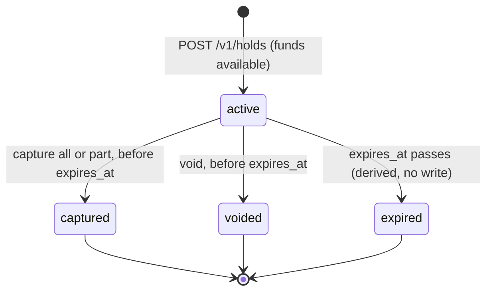

# ledgerline design notes

These notes explain what the service guarantees, how the code enforces each
guarantee, and which alternatives were considered. Code references point at
`src/ledgerline/`.

## Contents

1. [Goals and non-goals](#1-goals-and-non-goals)
2. [Double-entry bookkeeping as implemented](#2-double-entry-bookkeeping-as-implemented)
3. [Money as integer minor units](#3-money-as-integer-minor-units)
4. [Immutability and reversals](#4-immutability-and-reversals)
5. [Storage model](#5-storage-model)
6. [The write path](#6-the-write-path)
7. [Concurrency control](#7-concurrency-control)
8. [Idempotency](#8-idempotency)
9. [Point-in-time balances and statements](#9-point-in-time-balances-and-statements)
10. [Holds (two-phase transfers)](#10-holds-two-phase-transfers)
11. [Reconciliation](#11-reconciliation)
12. [Errors, logging and authentication](#12-errors-logging-and-authentication)
13. [Testing strategy](#13-testing-strategy)
14. [Out of scope](#14-out-of-scope)
15. [Common questions](#15-common-questions)
16. [References](#16-references)

## 1. Goals and non-goals

The service records money movements so that:

- the books always balance (every movement has an equal and opposite side);
- history is append-only and auditable;
- a retried request never moves money twice;
- concurrent requests never overdraw an account or lose an update;
- funds reserved by a hold cannot be spent twice, and a hold is captured,
  voided or expires exactly once;
- every guarantee is checked by tests, and the cached state can be re-verified
  from the journal at any time (`ledgerline reconcile`).

It is small on purpose: one service, one database, synchronous request
handling. Payments rails, FX, multi-tenancy and horizontal scaling are out of
scope (section 14).

## 2. Double-entry bookkeeping as implemented

### Accounts and normal balances

Every account has a type, and the type decides which side makes it grow (its
*normal balance*):

| Type | Grows with | Example |
| --- | --- | --- |
| asset | debits | cash at the bank |
| expense | debits | card-processing fees |
| liability | credits | a customer's wallet: money the platform owes the customer |
| equity | credits | owner's capital |
| revenue | credits | fees earned |

`domain.default_normal_balance` encodes this table. A caller may override it
for contra accounts (accumulated depreciation is an asset account that grows
with credits).

### Signed entries

A journal transaction is a list of entries. Each entry has an account, a
currency and a signed integer amount: **positive for a debit, negative for a
credit**. With that convention, "total debits equal total credits" becomes
"the amounts sum to zero", checked per currency by `domain.validate_entries`.

Balances are reported in each account's own terms (`domain.balance_change`):

```text
debit-normal account:   balance = sum(amounts)
credit-normal account:  balance = -sum(amounts)
```

So a wallet holding $75.00 reports `7500` even though it was built from
credits, and "below zero" means the same thing for every account.

### Worked example (the README walkthrough)

| Transaction | Cash at bank (asset) | Alice wallet (liability) | Bob wallet (liability) |
| --- | --- | --- | --- |
| Deposit $100 | `+10000` debit, balance 10000 | `-10000` credit, balance 10000 | |
| Alice pays Bob $25 | | `+2500` debit, balance 7500 | `-2500` credit, balance 2500 |
| Reversal of the payment | | `-2500` credit, balance 10000 | `+2500` debit, balance 0 |

Each row sums to zero, so the whole journal does too (the *trial balance*).
The accounting equation holds at every step: assets (10000) equal liabilities
(Alice + Bob).

### Rules every transaction must satisfy

`domain.validate_entries` runs before the database is touched:

- at least two entries;
- no zero amounts, and every amount within +/-(2^53 - 1) (section 3);
- each account at most once, so every statement line has one well-defined
  running balance and no intermediate state can look like an overdraft;
- the amounts sum to zero **per currency**. A USD leg can never be balanced by
  a EUR leg, which is why `+100 USD, -100 EUR` is rejected.

After loading the accounts, `domain.check_currencies` requires each entry to be
in its account's currency, and `domain.apply_entries` computes each new balance
and raises `InsufficientFunds` if an account with `allow_negative: false`
would drop below zero.

### Transfers

`POST /v1/transfers` takes `from`, `to` and a positive amount. "From" loses
value and "to" gains it, which is only unambiguous when both accounts grow on
the same side: two wallets, or two bank accounts. For two credit-normal wallets
the source is debited and the destination credited; for two debit-normal
accounts it is the other way round (`domain.transfer_entries`). A deposit, by
contrast, makes *both* sides grow (debit cash, credit the wallet), so mixed
cases are rejected with `invalid-transfer` and must be posted as explicit
journal transactions, where the caller states the debits and credits.

### Multiple currencies

An account holds exactly one currency and the ledger never converts. A foreign
exchange is modelled as one transaction with a balanced USD pair and a
balanced EUR pair, routed through conversion accounts; the test suite includes
such a transaction.

## 3. Money as integer minor units

Amounts are integers in the currency's minor unit (cents for USD).

- **Not floats:** binary floating point cannot represent 0.10 exactly, and
  rounding errors accumulate. Strict validation (`schemas.SignedAmount`,
  `strict=True`) rejects `12.5` and also `"1250"` and `true`, so nothing is
  coerced silently.
- **Not decimals:** `Decimal` would work, but integers make the invariants
  exact equalities, map to `BIGINT` on both databases, and leave no rounding
  mode to argue about. Formatting for display is the client's job.
- **Bounded:** amounts and balances stay within +/-(2^53 - 1)
  (`domain.MAX_MAGNITUDE`). That is the largest integer a JavaScript client can
  parse from JSON without rounding, and it fits comfortably in a signed 64-bit
  column. The bound covers the held and available balances of section 10 too:
  funds limit the holds of an account that cannot go negative, but not of one
  that can, so a hold that would take `held_amount` above 2^53 - 1, or a hold or
  posting that would take `available_balance` below -(2^53 - 1), is refused.
  Without that check such an account could stack holds without end, and on
  SQLite the `SUM` of about 1,025 maximal holds overflows 64 bits.

The minor-unit exponent (2 for USD, 0 for JPY) is not stored; the service never
needs it because it never converts or formats amounts.

## 4. Immutability and reversals

Posted transactions and entries are never updated or deleted; there is simply
no code path that does it. (In production I would also revoke `UPDATE` and
`DELETE` on those tables from the application's database role.)

A correction is a **reversal**: a new transaction whose entries are the
original's with the signs flipped (`domain.reversal_entries`), linked through
`transactions.reverses_id`. Consequences:

- The statement shows the original, the reversal and why (the reversal's
  description), which is what an auditor expects.
- `UNIQUE (reverses_id)` lets each transaction be reversed at most once; the
  service checks first so the client gets `409 already-reversed` instead of a
  constraint error.
- Reversing a reversal is refused (`422 reversal-not-allowed`). "Un-reversing"
  is a new business event and should be posted as one.
- A reversal is an ordinary posting, so it obeys the overdraft rule: if Alice
  has already spent a deposit, reversing the deposit fails with
  `insufficient-funds`. Recovering that money is a separate process.
- Point-in-time balances before the reversal still show the original effect
  (README step 8).

## 5. Storage model

Five tables, created by the migrations in `migrations/versions/` (0001 for the
ledger, 0002 for holds) and mirrored by `models.py` (a test checks they agree):

| Table | Key columns | Constraints |
| --- | --- | --- |
| `accounts` | `balance BIGINT`, `version INTEGER`, `allow_negative` | `CHECK (allow_negative OR balance >= 0)`, enum CHECKs, index on `(created_at, id)` |
| `transactions` | `posted_at`, `reverses_id`, `hold_id` | FKs to `transactions.id` and `holds.id`, `UNIQUE (reverses_id)`, `UNIQUE (hold_id)` |
| `holds` | `amount`, `status`, `captured_amount`, `created_at`, `expires_at`, `closed_at` | `CHECK`s on the amount, the stored status and the fields each status sets (section 10), index on `(from_account_id, status, expires_at)` |
| `entries` | `amount BIGINT`, `currency`, `balance_after` | `CHECK (amount <> 0)`, `UNIQUE (transaction_id, account_id)`, FKs, index on `(account_id, id)` |
| `idempotency_keys` | `(principal, key)` primary key, `fingerprint`, `response_body` | the primary key arbitrates races |

**Why cache a balance at all?** Reading `SUM(amount)` on every write is O(number
of entries) and still racy without locks. A stored balance makes reads O(1) and
gives every write one row to check and update. The cost is a denormalisation
that must never drift, so it changes only together with the entries, guarded
by the version column, and `ledgerline reconcile` re-derives it.

**Constraints are a backstop, not the main check.** The service validates
everything first so clients get precise errors. The constraints exist so that
even a bug in the service cannot store a zero amount, duplicate a leg, reverse
twice or overdraw an account; such a bug would surface as a 500 with a logged
`IntegrityError` instead of as corrupted books.

Timestamps use a small `UtcDateTime` type: PostgreSQL stores `timestamptz`,
SQLite stores naive text, and the type normalises both to timezone-aware UTC.

**Migrations.** The schema changes only through Alembic revisions, and tests
check that `alembic upgrade head` builds exactly what the models describe.
Revision 0002 adds `transactions.hold_id`. SQLite cannot add a foreign key to
an existing table, so Alembic's batch mode rebuilds the table: copy, drop the
old table, rename the copy. With `PRAGMA foreign_keys = ON` (which `db.py` sets
on every connection) the drop fails as soon as `entries` reference any
transaction; a test that upgrades a 0001 database holding data showed it.
`migrations/env.py` therefore follows SQLite's documented procedure for such
changes: it turns enforcement off for the migration connection, runs all
revisions in one transaction (the explicit `BEGIN IMMEDIATE` makes SQLite DDL
transactional), runs `PRAGMA foreign_key_check` before committing and turns
enforcement back on. The rebuild is given the table definition (`copy_from`),
so it needs no reflection and `alembic upgrade head --sql` still works offline.
PostgreSQL adds the column and constraints with plain `ALTER TABLE`.

## 6. The write path

Every money-moving request runs `LedgerService._write`, one database
transaction per attempt:

```text
for attempt in 1..10:
    BEGIN
      record = SELECT * FROM idempotency_keys WHERE principal = ? AND key = ?
      if record: COMMIT and return the stored response (or 409 if the fingerprint differs)

      accounts = SELECT * FROM accounts WHERE id IN (...)
      check currencies, compute new balances, refuse overdrafts     -- domain.py
      posted_at = now()
      for each account, in sorted id order:
          UPDATE accounts SET balance = ?, version = version_read + 1
          WHERE id = ? AND version = version_read                  -- compare-and-swap
          if 0 rows changed: ROLLBACK, back off, retry
      INSERT INTO transactions ...; INSERT INTO entries ...
      INSERT INTO idempotency_keys (principal, key, fingerprint, response_body)
          if the primary key already exists: ROLLBACK, back off, retry (and replay)
    COMMIT
raise ConcurrentUpdate  (409, Retry-After: 1)
```

Business-rule failures (unknown account, unbalanced entries, insufficient
funds) raise immediately and roll back; only conflicts are retried.

## 7. Concurrency control

### The race

```text
T1: read Alice = 100           T2: read Alice = 100
T1: 100 - 80 >= 0, ok          T2: 100 - 70 >= 0, ok
T1: write Alice = 20           T2: write Alice = 30      <- T1's withdrawal is lost
```

Both requests saw enough money, both succeeded, $150 left a $100 account, and
the stored balance no longer matches the entries. Every approach below
prevents this by making the read-check-write sequence atomic per account.

### Options considered

1. **Pessimistic locking (`SELECT ... FOR UPDATE`).** Lock the account rows
   before reading them; a second writer waits until the first commits, then
   reads the new balance. No retries, and contention turns into queueing.
   Costs: lock waits hold connections, every writer pays for locking even when
   there is no conflict, lock order must be managed to avoid deadlocks, and
   SQLite has no row locks.
2. **Optimistic concurrency (chosen).** Read without locks, decide, then write
   with `UPDATE ... WHERE id = ? AND version = ?`. If someone else changed the
   row since the read, zero rows match, and the whole attempt rolls back and
   retries with fresh data. Costs: wasted work and retries under contention,
   and a request can give up (`409 concurrent-update`) on a very hot account.
3. **`SERIALIZABLE` isolation.** Let PostgreSQL detect conflicts and retry on
   serialization failures. Correct and general, but behaviour differs between
   databases and failures are reported less precisely.
4. **A single conditional update**
   (`UPDATE ... SET balance = balance - :x WHERE id = :id AND balance >= :x`).
   Atomic and lock-based in effect. It works well for one account, but a
   multi-leg posting also needs each account's exact new balance for
   `balance_after`, and all legs must succeed or fail together.

I chose optimistic versioning because:

- the decision (is this posting allowed, what are the new balances?) stays in
  plain Python (`domain.py`) that is unit-tested without a database, and the
  database only answers "is my read still current?";
- the same code runs on PostgreSQL and on SQLite, which has no `SELECT ... FOR UPDATE`;
- conflicts are explicit, so tests can force them (`test_concurrency.py`
  replaces the compare-and-swap with one that fails twice and checks that the
  retry succeeds, and one that always fails and checks that retries stop);
- typical ledger traffic touches many different accounts, where optimistic
  control rarely conflicts.

### How the compare-and-swap behaves on each database

**PostgreSQL (Read Committed, the default).** If T2's `UPDATE` targets a row
that T1 has updated but not committed, T2 waits. When T1 commits, PostgreSQL
re-evaluates T2's `WHERE` clause against the new row version; the version no
longer matches, so T2 updates zero rows and retries. If T1 rolls back instead,
T2's update proceeds. Correctness therefore does not depend on a stricter
isolation level.

**SQLite.** SQLite allows one writer at a time. `db.py` makes every transaction
start with `BEGIN IMMEDIATE`, so writers queue for the lock (up to a 30-second
busy timeout) instead of reading concurrently and then failing to upgrade to a
write lock with "database is locked". Writers are fully serialised, so the
compare-and-swap never fails on SQLite; the threaded tests still check that there
are no lost updates, and they exercise real conflicts when run on PostgreSQL
(locally through pgserver, and in CI).

### Deadlocks

Two transactions that update the same accounts in different orders can each
hold one row lock and wait for the other. `_post` always updates accounts in
sorted id order, so lock acquisition order is consistent and that cycle cannot
form.

### Retries

Up to 10 attempts, with exponential backoff and full jitter capped at 50 ms
between them (`service._backoff`), so requests that collided do not retry in
lockstep. After the last attempt the client gets `409 concurrent-update` with
`Retry-After: 1`; nothing was written, and retrying with the same
`Idempotency-Key` is safe.

### When I would switch approach

If a few accounts are extremely hot (a fee account, a settlement account),
optimistic retries waste work and can starve. Options then: row locks
(`SELECT ... FOR UPDATE`) for those writes, a per-account queue or single
writer, or splitting a hot account's balance across several sub-account rows
that are summed on read.

## 8. Idempotency

### Contract

- `Idempotency-Key` is required on money-moving `POST`s (transactions,
  transfers, reversals) and optional on `POST /v1/accounts`.
- Same key and same request: the original status and body are replayed, with
  `Idempotent-Replayed: true`.
- Same key and a different request: `409 idempotency-key-reused`.
- Concurrent duplicates: exactly one takes effect; the others replay it.

### Design

- **Scope.** Keys are stored per client: the primary key is
  `(principal, key)`, where `principal` is a fingerprint of the API key. Two
  clients choosing the same key cannot collide or read each other's responses.
- **Fingerprint.** SHA-256 of the method, the path and the *validated* body
  serialised as canonical JSON (sorted keys, no whitespace), so a retry with
  reordered fields still matches, while a different amount or a different
  endpoint does not.
- **Atomic with the effect.** The idempotency row is inserted in the same
  database transaction as the ledger changes. If the server crashes before the
  commit, nothing happened and a retry executes normally; if it crashes after
  the commit but before responding, the retry finds the row and replays. There
  is no window in which money moved but the key was not recorded.
- **Races.** Two identical requests can both find no record and both do the
  work. Only one can insert `(principal, key)`; the other gets a primary-key
  violation (on PostgreSQL it first waits for the winner's uncommitted
  insert), rolls back its own ledger changes, retries, and replays the
  winner's response. In practice the loser usually fails the balance
  compare-and-swap first, with the same outcome. `test_concurrency.py` forces
  this path deterministically.
- **Only successes are stored.** A request that fails validation or a business
  rule rolls back entirely, the key included, so the client can fix the
  problem and retry with the same key. Stripe instead stores the outcome of any
  request that started executing; storing failures makes "the outcome of this
  key" final but forces clients to mint a new key after, say, a top-up. For a
  ledger I preferred the simpler rule that only an effect is recorded.
- **Status code for mismatches.** The IETF Idempotency-Key draft suggests 422
  for a reused key with a different payload; this service returns 409 because
  the request conflicts with state the server already holds (the key is taken).
- **Retention.** Records are kept forever. A production system would expire
  them after a window (Stripe uses 24 hours) with a cleanup job.

## 9. Point-in-time balances and statements

`GET /v1/accounts/{id}/balance?as_of=T` sums the account's entries whose
transaction has `posted_at <= T`; history is rebuilt from the immutable
journal, not from the cached balance.

For that history to be consistent, `posted_at` must order transactions on the
same account the way they were applied. `_post` takes the timestamp *after*
reading the account rows. A successful attempt read the current version of
every account it touches (otherwise its compare-and-swap would fail), so any
earlier transaction on those accounts had committed before the read, and
therefore before this timestamp. Per account, `posted_at` order matches commit
order. This assumes a single server clock; with several application servers,
clock skew could reorder history (balances themselves stay correct).

Statements (`GET /v1/accounts/{id}/entries`) list entries in id order with
`balance_after`, the account's balance right after the entry, written in the
same transaction as the entry. The state-machine test re-derives every running
balance after each step.

Lists use **keyset pagination**: the opaque cursor encodes the last row's sort
key (`(created_at, id)` for accounts, entry id for statements), and the next
page starts strictly after it. Unlike `OFFSET`, this stays fast on large tables
and does not skip or repeat rows when new rows are appended. Its blind spot is a
row that commits later with a smaller key than a page the client has already
read.

## 10. Holds (two-phase transfers)

Card payments and marketplaces reserve money before they move it: a card is
authorized when the customer orders and captured when the goods ship, often
for a different amount. A **hold** is that reservation. It is a transfer in
two phases: authorize now, then capture (post) or void (release) later, or
let it expire. TigerBeetle's pending transfers and Stripe's manual capture
have the same shape ([references](#references-for-holds)).

### Three balances

| Field | Meaning |
| --- | --- |
| `balance` | The **ledger balance**: posted entries only. A hold never changes it. |
| `held_amount` | The total of the account's active holds, as the source. |
| `available_balance` | `balance - held_amount`: what the account can still spend or hold. |

The funds rule changes from "the balance may not go below zero" to "the
**available** balance may not go below zero", for accounts with
`allow_negative: false`. It applies to every posting (transfers, journal
transactions, reversals) and to new holds (`domain.apply_entries`). If
postings could spend held money, a later capture could fail and a hold would
reserve nothing. A hold's destination sees nothing until the capture posts:
pending credits are not counted as available, so money cannot be spent before
it arrives.

### The state machine



`domain.HOLD_TRANSITIONS` holds the same table, and the property test checks
every status change it observes against it. Only `active`, `captured` and
`voided` are stored. Each stored status carries exactly the fields its
transition sets, and `CHECK` constraints enforce the combinations:

| Stored status | `closed_at` | `captured_amount` | Journal |
| --- | --- | --- | --- |
| `active` | null | null | nothing |
| `captured` | the capture's `posted_at` | between 1 and `amount` | exactly one transaction with `hold_id` set |
| `voided` | when it was voided | null | nothing |

One constraint needed an explicit `captured_amount IS NOT NULL`: a `CHECK`
rejects a row only when its expression is false, and `NULL > 0` is null, so
without it a captured hold with no amount was accepted. A constraint test
caught that before it shipped.

**Capture** posts a transfer of `amount` (by default the whole hold) from the
source to the destination as one journal transaction, and releases the rest.
`transactions.hold_id` links the posting to its hold and is `UNIQUE`, so a
hold reaches the journal at most once, the same way `UNIQUE (reverses_id)`
limits reversals. The funds check on the capture leaves out the hold being
captured, because its funds are the posting itself. If the holds fit the
balance before, the capture always fits: the available balance after it is
the available balance before plus the released remainder. A Hypothesis
property in `test_domain.py` checks exactly that equation. A capture can be
refunded by reversing its transaction; the hold stays `captured`.

**Void** releases the whole hold and posts nothing.

### Expiry is lazy

An active hold whose `expires_at` has passed is reported as `expired`, stops
counting toward `held_amount`, and can be neither captured nor voided
(`409 hold-expired`). Nothing is written when that happens: the stored status
stays `active`, and every query that sums holds also filters on
`expires_at > now`.

The alternative was explicit expiry: a background job that marks expired
holds and releases their funds. I chose lazy expiry because:

- the service is one process with synchronous request handling and no
  scheduler, and lazy expiry needs none;
- a hold stops counting exactly at `expires_at`, not whenever the job next
  runs. With a sweeper, a hold would keep reducing the available balance
  after expiry until the sweep, and capture would still have to check the
  time to refuse a late capture, so the job would add nothing to correctness;
- reads stay read-only.

The costs: the raw `holds.status` column says `active` for an expired hold, so
anything that reads the table directly must apply the same `expires_at` rule
(the index on `(from_account_id, status, expires_at)` serves it); two reads a
second apart can show different available balances with no write in between;
and nothing fires at expiry. A system that must notify someone when a hold
lapses would add a job that emits events, without changing these rules.

`expires_at` is required: a hold that never lapsed would keep reducing the
available balance if its caller forgot it. It must be later than the server's
current time. There is no upper bound (section 14).

**The clock is injectable.** `LedgerService(clock=...)` and
`create_app(clock=...)` take a function that returns the current time, and
every timestamp and expiry decision uses it. Tests pass a fake clock, so they
check a hold one microsecond before its expiry (active, still capturable) and
exactly at it (expired) instead of sleeping.

**Point-in-time available balances.** Hold writes take their timestamp after
reading the account rows, as postings do (section 9), and a capture's
`closed_at` equals its transaction's `posted_at`. A hold counts as of time `T`
when `created_at <= T < closed_at` (or it is still open) and `T < expires_at`,
so `GET /v1/accounts/{id}/balance?as_of=T` reports the held and available
balance at `T` next to the ledger balance.

### Concurrency

Holds reuse the optimistic scheme from section 7. Every write that can change
an account's available balance goes through that account's compare-and-swap:

- **Authorize** changes no balance, but it rewrites the source account's row
  with the same balance and the next version. Concurrent holds and postings on
  one account therefore serialize, and each decides with fresh data. Forty
  concurrent 30-cent holds against 1,000 cents give exactly 33 holds and 7
  refusals, on SQLite and on PostgreSQL. With the version bump removed,
  PostgreSQL let 38 of the 40 through.
- **Capture and void** race on the hold row. The transition is a guarded
  `UPDATE holds SET status = ... WHERE id = ? AND status = 'active' AND
  expires_at > ?`. Only one statement can match an active row; on PostgreSQL
  the others wait for the winner's commit, re-check the `WHERE` clause and
  match nothing. The loser rolls back, retries, sees the closed hold and
  answers `409 hold-not-active`.
- **Order of writes in a capture.** The capture swaps the account balances,
  then closes the hold, then inserts the journal rows. Running the suite on
  PostgreSQL showed why the order matters. At Read Committed each statement
  sees what had committed when it started, so a capture can read the hold
  before a rival capture commits and read the accounts after it. Its balance
  compare-and-swap then passes. When the insert came first, the duplicate
  posting hit `UNIQUE (hold_id)` and the client got a 500; closing the hold
  first turns it into the retry above. A test reproduces the interleaving
  deterministically. The same reasoning moved the "already reversed?" check
  in reversals after the balance read, which fixed the same latent race there.
- **Lock order.** Accounts in id order, then the hold row, in every write that
  touches a hold. Voids rewrite the source account (version bump) before the
  hold row, so no two writers wait on each other in a cycle.

Voids bump the source version too. Releasing funds never makes anything
unsafe, but without the bump a concurrent hold that counted the voided hold
could be refused on stale data.

All three hold writes need an `Idempotency-Key` and use the machinery from
section 8. A replay returns the original response, even if the hold has since
expired or been captured; `GET /v1/holds/{id}` shows the current state.

**Compatibility.** Earlier responses stored under idempotency keys lack the
new response fields (`held_amount`, `available_balance`, `captures_hold_id`).
They replay unchanged because those fields default to what they meant before
holds existed: no holds, and no capture. A test replays such records.

### References for holds

- [TigerBeetle: two-phase transfers](https://docs.tigerbeetle.com/coding/two-phase-transfers/)
  (pending transfers that are later posted, possibly for less, or voided, and
  that time out)
- [Stripe: place a hold on a payment method](https://docs.stripe.com/payments/place-a-hold-on-a-payment-method)
  (authorize now, capture all or part later, cancel to release)
- [PostgreSQL: check constraints](https://www.postgresql.org/docs/current/ddl-constraints.html#DDL-CONSTRAINTS-CHECK-CONSTRAINTS)
  (a check constraint is satisfied when its expression is true or null)
- [SQLite: making other kinds of table schema changes](https://www.sqlite.org/lang_altertable.html#otheralter)
  and [Alembic: batch migrations for SQLite](https://alembic.sqlalchemy.org/en/latest/batch.html)

## 11. Reconciliation

`ledgerline reconcile` (`reconcile.py`) recomputes the invariants from the
entries and exits 1 if any fails:

1. each account's stored balance equals the signed sum of its entries, in the
   account's own terms;
2. every transaction's entries sum to zero per currency;
3. every entry uses its account's currency;
4. the trial balance (all entries per currency) is zero;
5. every hold's stored status, amounts and timestamps describe a path through
   the hold state machine: captured never exceeds authorized, and a hold was
   captured or voided at most once, after it was created and before it
   expired (`reconcile.hold_problems`);
6. active holds never exceed the ledger balance of an account that cannot go
   negative (expiry judged at the time `reconcile` runs);
7. every captured hold is in the journal exactly once, as a transaction that
   moves exactly the captured amount from the source to the destination, in
   the hold's currency, posted when the hold closed; and no transaction claims
   to capture a hold that is not captured.

Each check is a single SQL statement, so each sees a consistent snapshot even
while the API writes. Tests tamper with the database directly (a changed
balance, an unbalanced transaction, an entry in the wrong currency, a hold
reserving more than the balance, a capture closed after expiry or moved off
the journal, a capture with the wrong amount or time) and check that each is
reported. The database constraints already refuse some broken holds (a
captured amount above the authorized one, a stored `expired` status), so
`hold_problems` is also tested directly on such rows.

## 12. Errors, logging and authentication

**Errors.** Each domain exception class carries its HTTP status, problem type
and title (`errors.py`), and one handler turns any of them into an RFC 9457
document (`api/problems.py`). Request validation errors, unknown routes and
unexpected crashes use the same format, so clients parse one error shape.
Validation errors report location, message and type but never echo the
rejected input. The catalogue is in [errors.md](errors.md).

**Logging.** One JSON object per line. A pure ASGI middleware
(`api/middleware.py`) assigns each request an ID (or keeps a well-formed
incoming `X-Request-ID`), stores it in a context variable, times the request
and logs one line with method, path, status, duration and client. Context
variables follow the request into the worker thread that runs the endpoint,
so any log call made while handling the request carries the ID. Unhandled
exceptions are logged with their traceback and returned as a 500 problem that
includes the request ID, without internal details.

**Authentication.** Static bearer keys from `LEDGERLINE_API_KEYS`. The presented
key and each configured key are hashed with SHA-256 and compared with
`hmac.compare_digest`, so timing reveals neither the key's contents nor its
length, and every configured key is checked so timing does not reveal which
one matched. With no keys configured every `/v1` request is rejected. Logs and
idempotency records identify clients by a 16-hex-digit fingerprint of their key.
This is enough for a single trusted caller; section 14 covers what real
deployments need. A key from `ledgerline generate-key` belongs in a protected
environment or secret manager: never commit it or paste it into issues or logs,
and send it only over HTTPS.

**Why SHA-256 and not a password hash.** Code scanners such as CodeQL flag
SHA-256 on secrets like these keys because the same call would be wrong for
passwords. People choose passwords, so they have little entropy and need a
slow, salted hash that makes a stolen hash table expensive to attack. The keys
here are meant to be random tokens from `ledgerline generate-key`: 32 bytes
from the operating system's random source, or 256 bits. No hash speed makes
2^256 guesses feasible, so a fast hash gives nothing away, while a slow one
would add work to every authenticated request. Storing a plain SHA-256 of a
random API token is the common approach for this reason.

The remaining risk is a weak key that a person typed, such as the local
`dev-key-change-me` placeholder. Anyone who can read the logs or the
idempotency table could test guesses against its fingerprint offline (and,
with no rate limiting, online too). The service logs a warning at startup when
a configured key is shorter than 32 characters. Length is only a rough check;
the real requirement is a generated key.

Two stronger measures were considered and not adopted:

- **Rejecting short keys at startup** would break the local demos and still
  would not measure randomness.
- **An HMAC keyed with a separate server-side secret** would make leaked
  fingerprints useless without that secret. It adds a second secret to manage,
  and every fingerprint changes when the secret is introduced or rotated.
  Idempotency records are stored under the fingerprint, so a client retry that
  spans such a change would miss its stored response and could post twice.
  The trade is worth making only if hand-typed keys must be supported.

Any future change to the fingerprint must keep it stable across restarts and
database recovery, or migrate the stored idempotency records along with it. A
test pins the current derivation to a known value.

## 13. Testing strategy

| Layer | File | What it shows |
| --- | --- | --- |
| Domain rules | `test_domain.py` | Each rule in isolation, plus a Hypothesis property: any balanced posting validates and its reversal cancels it |
| HTTP API | `test_api_*.py`, `test_idempotency.py`, `test_http.py` | Every endpoint, error type, header and status code |
| State machine | `test_stateful.py` | Random operation sequences keep the invariants (below) |
| Concurrency | `test_concurrency.py` | No lost updates or overdrafts under simultaneous writers; one effect per key; retries and their bound |
| Holds, API | `test_api_holds.py` | Authorize, full and partial capture, void, expiry at its exact boundary, point-in-time available balances, idempotency, every hold error |
| Holds, state machine | `test_holds_stateful.py` | Random hold sequences against an in-memory model (below) |
| Holds, concurrency | `test_holds_concurrency.py` | Exactly the affordable set of concurrent holds succeeds; holds and transfers share one available balance; one capture or void wins; forced stale reads |
| Schema | `test_migrations.py`, `test_storage.py` | `alembic upgrade head` matches the models, keeps an existing ledger's rows, downgrades and works offline; the hold constraints refuse broken rows |
| Operations | `test_reconcile.py`, `test_cli.py`, `test_observability.py` | Reconciliation catches tampering; CLI exit codes; log format |

The Hypothesis `RuleBasedStateMachine` keeps a model of every balance and
predicts each request's outcome: success, `insufficient-funds`,
`already-reversed`, `reversal-not-allowed`, a replay or
`idempotency-key-reused`. After every step it asserts that stored balances
equal the model (so replays and rejected requests changed nothing), that
`reconcile` passes (stored balance equals the sum of entries, transactions and
the trial balance are zero per currency), that no non-negative account is below
zero, and that every `balance_after` matches the running sum. When a sequence
fails, Hypothesis shrinks it to a minimal reproduction.

To check that the state machine has teeth, I temporarily broke the service
three ways (skipping one account's balance update, never storing idempotency
records, and writing the pre-posting balance into `balance_after`); the test
failed on each.

The hold state machine test works the same way with its own model of
accounts and holds and a fake clock that a rule moves forward, so holds expire
mid-sequence. It predicts every response (status code, problem type, the
hold's new state) and every ledger, held and available balance, checks that
each hold's status only moves along an edge of `HOLD_TRANSITIONS`, and runs
`reconcile` after every step. It also authorizes amounts near the whole
available balance, where holds, captures and transfers compete for the last
units. I broke the hold code nine ways and checked that tests fail: postings
ignoring holds, sums of holds ignoring expiry, expiry one tick late, partial
captures taking everything, a capture counting its own hold against itself,
an unguarded state transition, reconcile skipping the capture legs, the
migration keeping foreign keys enforced, and authorizations not bumping the
account version. Each one failed at least one test. Run on its own, the
state machine test caught the five that change what the API answers to
sequential requests. The other four need a race, a tampered database or a
migration to show; the targeted tests caught them, the version-bump mutant
only on PostgreSQL, where the requests really race.

The whole suite runs on SQLite by default and on PostgreSQL when
`DATABASE_URL` points at a database whose name contains `test`.

### Invariants, and where each is enforced and checked

| Invariant | Enforced by | Checked by |
| --- | --- | --- |
| Every transaction has two or more non-zero entries on distinct accounts and sums to zero per currency | `domain.validate_entries`; `CHECK (amount <> 0)`, `UNIQUE (transaction_id, account_id)` | Unit tests, API tests, state machine, `reconcile` |
| The trial balance is zero for every currency | Follows from the row above | State machine, `reconcile` |
| A stored balance equals the sum of its account's entries | Balance and entries change in one DB transaction, guarded by the version check | State machine, threaded tests, `reconcile` |
| An account with `allow_negative: false` never goes below zero | `domain.apply_entries` + compare-and-swap; `CHECK (allow_negative OR balance >= 0)` as a backstop | Threaded overdraft test, state machine |
| Posted transactions never change; each has at most one reversal, which cannot itself be reversed | No update or delete paths; `UNIQUE (reverses_id)` | API tests, state machine |
| One idempotency key, one effect | Response stored under `PRIMARY KEY (principal, key)` in the same DB transaction as the effect | Threaded duplicate test, forced key-race test, state machine replays |
| Statement running balances match the entries | `balance_after` written with each entry | State machine |
| Active holds never exceed the balance of an account with `allow_negative: false`; postings cannot spend held funds | Every posting and hold checks the available balance; every write that changes it compare-and-swaps the account's version | Hold state machine, threaded hold tests, `reconcile` |
| A hold moves only from active to captured, voided or expired, once; captured never exceeds authorized | Guarded `UPDATE ... WHERE status = 'active' AND expires_at > now`; `CHECK`s on the fields each status sets | Hold state machine, race tests, constraint tests, `reconcile` |
| Each captured hold is in the journal exactly once, for the captured amount | `UNIQUE (hold_id)` on transactions; the hold is closed before the posting is inserted | Race tests, `reconcile` |

### What CI runs

GitHub Actions runs ruff, strict mypy and the suite with coverage on Python 3.12
and 3.13 against SQLite, then the migrations and the suite against a PostgreSQL 17
service container. It validates `docker-compose.yml`, builds the image and
smoke-tests the running container (health check, `/healthz`, `/readyz` and an
authenticated API call).

A last job starts the compose stack (the API and PostgreSQL 17) and drives it
with `scripts/compose_smoke.py`. The script opens accounts, posts a deposit and a
transfer, and checks a replayed retry, a rejected key reuse and a refused
overdraft. It sends 20 concurrent transfers that together ask for more than the
wallet holds; exactly the 15 that fit must succeed. It then sends 25 concurrent
holds against a second wallet, of which exactly 20 must succeed, captures part of
one, voids another and checks the ledger, held and available balances. Finally
it runs `ledgerline reconcile` inside the API container.

## 14. Out of scope

- **FX conversion.** Rates, rounding policy, quote expiry and the accounts for
  FX gains and losses are a product in themselves. The ledger already supports
  the bookkeeping (one transaction balanced per currency through conversion
  accounts); the conversion logic would live in a separate service that posts
  to it. Currency codes are checked for format (three capital letters), not
  against the ISO 4217 list.
- **Multi-tenant authorization.** Today every key can touch every account. A
  real ledger needs tenants (a `tenant_id` on every row, enforced in every
  query or with PostgreSQL row-level security), per-client scopes such as
  read-only or per-account-group access, and identity from OAuth 2.0/OIDC or
  mTLS rather than shared secrets.
- **Sharding.** One PostgreSQL primary goes a long way for a ledger. Beyond it,
  accounts could be partitioned by tenant; a transaction spanning shards then
  needs a coordination protocol (for example a two-phase pending/posted
  transfer model), which is a large step up in complexity.
- **Event streaming.** Downstream consumers (notifications, analytics) should
  learn about postings without dual writes. The usual fix is a transactional
  outbox: insert an event row in the same database transaction as the posting
  and publish it to a broker from a separate relay.
- **More hold features.** One capture per hold (no incremental or multiple
  partial captures), no increasing an existing hold, no listing of holds per
  account, no maximum hold duration, and no pending credits on the
  destination side. Each is an extension of the same state machine.
- Also not built: backdated entries, account updates or closure, transaction search,
  rate limiting, metrics and tracing export.

## 15. Common questions

**Why not store amounts as floats or decimals?** Floats cannot represent most
decimal fractions exactly. Decimals would work, but integers of minor units
make every invariant an exact integer equality and avoid rounding policy.

**Why keep a stored balance if it can be computed from entries?** O(1) reads and
one row to compare-and-swap on writes. The price is a cache that must never
drift, hence the version check, the single transaction and `reconcile`.

**Two requests withdraw from the same account at the same time. What happens?**
Both read version *n*. The first compare-and-swap moves the row to *n + 1*. On
PostgreSQL the second waits for the first to commit, re-checks its `WHERE`
clause, matches zero rows, rolls back and retries against the new balance, so
the overdraft rule is applied to fresh data. On SQLite the second simply waits
for the write lock.

**What if the server crashes after committing but before responding?** The
client retries with the same key; the idempotency row was committed with the
transfer, so it gets the original response, not a second transfer.

**Why is the key scoped per API client?** Otherwise two clients picking the same
key would collide, and one could receive the other's stored response.

**Why are only successful responses stored?** A failure leaves no trace in the
database, which keeps the write atomic and lets a client retry the same logical
request after fixing the cause. Section 8 covers the trade-off against Stripe's
behaviour.

**Why can a transfer not go from a cash account to a wallet?** Because "from"
and "to" are ambiguous across normal-balance sides: a deposit increases both
accounts. Those movements are explicit journal transactions.

**Why `BEGIN IMMEDIATE` on SQLite?** A deferred transaction reads under a
shared lock and then needs to upgrade to a write lock; two such transactions
deadlock, and SQLite reports that as "database is locked". Taking the write
lock up front makes writers queue instead.

**Why does a hold not post anything until it is captured?** The journal
records what happened; an authorization is a promise that may still be
voided or expire. Keeping it out of the journal means the ledger balance and
the statements show only settled money, while the available balance shows what
is free to spend.

**What stops a transfer from spending money a hold reserved?** Every posting
checks the available balance, not the ledger balance, and every write that
changes either goes through the source account's compare-and-swap.

**A capture and a void arrive at the same time. What happens?** Both read the
hold as active. The guarded `UPDATE ... WHERE status = 'active'` lets exactly
one of them move it; the other rolls back, retries, sees the closed hold and
gets `409 hold-not-active`.

**Why lazy expiry instead of a job?** It needs no scheduler, a hold stops
counting exactly at `expires_at`, and reads never write. Section 10 lists what
it costs.

**How would you scale it?** PostgreSQL first: connection pooling, read replicas
for statements and history, and partitioning the `entries` table by time. Then
hot-account mitigation (section 7) and a transactional outbox for consumers.
Sharding by tenant comes last, because cross-shard transfers need a two-phase
protocol.

## 16. References

- [RFC 9457: Problem Details for HTTP APIs](https://www.rfc-editor.org/rfc/rfc9457)
- [The Idempotency-Key HTTP Header Field (IETF draft)](https://datatracker.ietf.org/doc/draft-ietf-httpapi-idempotency-key-header/)
- [Stripe API: idempotent requests](https://docs.stripe.com/api/idempotent_requests)
- [TigerBeetle: two-phase transfers](https://docs.tigerbeetle.com/coding/two-phase-transfers/)
- [Stripe: place a hold on a payment method](https://docs.stripe.com/payments/place-a-hold-on-a-payment-method)
- [PostgreSQL: transaction isolation](https://www.postgresql.org/docs/current/transaction-iso.html),
  including how `UPDATE ... WHERE` behaves under concurrent updates at Read Committed
- [SQLite: BEGIN IMMEDIATE](https://www.sqlite.org/lang_transaction.html)
- [Exponential Backoff and Jitter (AWS Architecture Blog)](https://aws.amazon.com/blogs/architecture/exponential-backoff-and-jitter/)
- Martin Kleppmann, *Designing Data-Intensive Applications*, chapter 7
  (transactions, lost updates and write skew)
